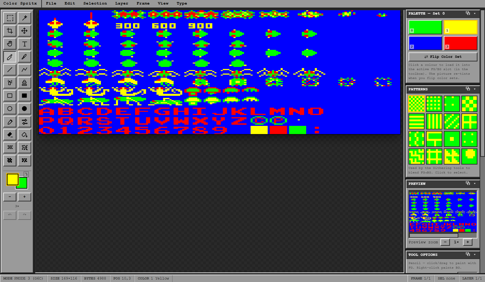

# Color Spritx

A browser-based pixel-art editor for the **TRS-80 Color Computer (CoCo)**, built specifically for the 4-color **PMODE 1** and **PMODE 3** graphics modes. It combines a classic Deluxe-Paint-style interface with authentic CoCo hardware constraints, so what you draw is what you actually get on real hardware or an emulator.

Color Spritx ships as a **single self-contained HTML file** — no install, no build step, no dependencies to manage. Open it in a browser and start drawing.

© 2026 Carlos A. Camacho

---

## Table of Contents

- [What It Is](#what-it-is)
- [Quick Start](#quick-start)
- [Hardware Model](#hardware-model)
- [The Interface](#the-interface)
- [Tools](#tools)
- [Dithering](#dithering)
- [Patterns](#patterns)
- [Colors & Palettes](#colors--palettes)
- [Layers, Frames & Animation](#layers-frames--animation)
- [Spritesheet Mode](#spritesheet-mode)
- [Importing & Exporting](#importing--exporting)
- [The Fast BASIC Loader](#the-fast-basic-loader)
- [Keyboard Shortcuts](#keyboard-shortcuts)
- [Tips & Notes](#tips--notes)
- [Technical Details](#technical-details)
- [Credits](#credits)

---

## What It Is

The Color Computer's 4-color graphics modes are unusual: a single fixed screen shows either 128×96 dots (PMODE 1) or 128×192 dots (PMODE 3), always filling the same 4:3 television frame. Color Spritx models this faithfully — the right palettes, the right proportions, the right pixel layout — and then layers a modern, comfortable editing experience on top.

The result is a tool that lets you design CoCo sprites and screens visually, then export them in the exact byte format the machine expects: raw binary, 6809 assembly source, or a self-loading BASIC program.

## Quick Start

1. Open `index.html` in any modern browser (Chrome, Firefox, Safari, Edge).
2. The canvas opens in PMODE 3 (128×192) by default.
3. Pick a color from the **Palette** panel — it loads into the foreground slot in the toolbox.
4. Choose the **Pencil** and start drawing.
5. When you're done, use **File → Export** to save your work as a CoCo binary, assembly source, BASIC loader, PNG, or a Color Spritx project file.

For a new canvas, use **File → New Image…** (PMODE 1 or 3) or **File → New Spritesheet…**.

## Hardware Model

On a real CoCo, every dot is a perfect **square**, and lower-resolution modes simply use *bigger* square dots. The whole picture always fills the same physical 4:3 screen. Color Spritx reflects this with two views, toggled from **View → Fit to TV Screen (4:3)**:

- **Square dots** — every dot is drawn 1:1. PMODE 3 looks like a narrow 128×192 grid; PMODE 1 like 128×96. Best for precise editing.
- **Fit to TV (default ON)** — the picture is stretched to fill the true 4:3 frame. PMODE 3 dots are drawn twice as wide; PMODE 1 dots twice as wide and twice as tall. This is how the image actually appears on a CoCo.

The preview window mirrors whichever view the canvas is in.

| Mode | VDG | Dots | Buffer |
|------|-----|------|--------|
| PMODE 1 | G3C | 128 × 96 | 3,072 bytes |
| PMODE 3 | G6C | 128 × 192 | 6,144 bytes |

Both modes are 4 colors, 2 bits per pixel, 4 pixels per byte, MSB-first.

## The Interface

The layout follows the classic gray-bevel "Deluxe Paint" convention:

- **Menu bar** — Color Spritx (About / shortcuts), File, Edit, Selection, Layer, Frame, View, Type.
- **Toolbox** (left) — all tools in a two-per-row grid, the overlapping foreground/background color slots, zoom controls, and undo/redo.
- **Canvas stage** (center) — the editing surface, scrollable and zoomable.
- **Right panels** — Palette, Patterns, Preview, Tool Options, and (in spritesheet mode) Sprites. Each panel can be collapsed or floated into a draggable window.
- **Status bar** (bottom) — current mode, size, byte count, cursor position, active color, and frame/layer info.

The **Tool Options** panel updates to show only the settings that apply to the currently selected tool.

## Tools

Tools are arranged two per row:

| | |
|---|---|
| **Marquee Selection** — drag a rectangular selection | **Magic Wand** — select a contiguous region of one color |
| **Crop** — resizable crop box; click outside to apply | **Selection Move** — reposition a floating selection or layer |
| **Pan** — drag to scroll when zoomed in | **Type** — place text in a pixel font |
| **Pencil** — freehand 1-pixel drawing | **Brush** — thicker freehand stroke |
| **Line** — straight line (Shift locks to 45°/axis) | **Shape** — multi-point polyline; double-click to finish |
| **Spray** — airbrush with density/speed control | **Stamp** — stamp down the copied selection |
| **Box Empty** — rectangle outline | **Box Filled** — solid rectangle |
| **Circle Empty** — ellipse outline | **Circle Full** — solid ellipse |
| **Color Picker** — sample a pixel's color | **Replace Color** — swap one color for another |
| **Eraser** — paint with the background color | **Bucket Fill** — flood-fill a region |
| **Dithering Atkinson** | **Dithering Noise** |
| **Dithering Ordered (Bayer)** | **Dithering Floyd–Steinberg** |

**Per-tool options** include brush size (Pencil, Brush, Eraser, Line, Shape, Spray), border thickness (Box Empty, Circle Empty), spray density and speed, dither direction, and a "use selected pattern" checkbox (Brush, Bucket Fill, Box Filled, Circle Full, Spray).

The **Type** tool works in three steps: click to start, type your text (drag to reposition it), then click again to drop the text onto a brand-new layer named after the first 12 characters. Fonts and size are chosen from the **Type** menu, with six pixel-style Google fonts available. Text is rendered hard-edged with no anti-aliasing.

## Dithering

Four dithering tools blend the foreground color into the background across a drag, using **only those two colors** — exactly the constraint a 4-color CoCo screen imposes when you want a two-tone gradient. Each works the same way: drag from the start point to the end point, and set the gradient **direction** (8 options in 45° steps) in Tool Options.

- **Atkinson** — error-diffusion with a light, airy texture.
- **Floyd–Steinberg** — error-diffusion with a denser, smoother distribution.
- **Ordered (Bayer 4×4)** — a regular, geometric threshold matrix.
- **Noise** — random per-pixel threshold for a grainy look.

## Patterns

The **Patterns** panel offers 16 fill textures, rendered live in your current foreground/background colors. When a pattern-capable tool (Brush, Bucket Fill, Box Filled, Circle Full, Spray) has its "use pattern" option enabled, it fills with the selected pattern instead of a solid color.

The 16 patterns: Checkerboard, Sparse Checker, Very Sparse, Large Checkers, Horizontal Stripes, Vertical Stripes, Diagonal Lines, Cross-Hatch, Zig-Zag, Brick, Diamonds, Dots Grid, Weave, Plus Signs, Triangles, and Scales.

## Colors & Palettes

Color Spritx uses the two authentic MC6847 4-color sets:

- **Set 0** — Green, Yellow, Blue, Red
- **Set 1** — Buff, Cyan, Magenta, Orange

Pixels are stored as palette **indices** (0–3), so flipping between color sets re-tints the whole picture instantly without changing the data. Use **View → Switch Palettes** or the **Flip Color Set** button.

Foreground and background colors live in overlapping slots in the toolbox (Photoshop-style). Click a palette swatch to load it into the active slot; press **X** to swap foreground and background.

## Layers, Frames & Animation

- **Layers** — create, duplicate, delete, merge down, reorder (drag), toggle visibility, rename, clear, and fill. Index 0 is transparent for compositing.
- **Frames** — a timeline with thumbnails for new/duplicate/delete, play/stop at a set FPS, and onion-skinning (ghosts of the previous and next frames).

(Layers and frames are disabled in Spritesheet mode — see below.)

## Spritesheet Mode

**File → New Spritesheet…** sets up a grid of sprite cells inside a single PMODE image. You choose the mode, the per-sprite pixel size, and the number of columns and rows — the editor caps the count so the sheet never exceeds the PMODE screen.

In this mode:

- The **Sprites** panel lists every sprite with a thumbnail and an editable name.
- The selected sprite's cell shows a slowly flashing border (red/green/blue/green).
- Per-sprite operations: clear, rotate, flip horizontal/vertical, mirror left-onto-right, mirror top-onto-bottom, and copy one sprite's contents into another.
- All drawing tools work normally across the whole sheet; layers and animation are disabled.
- The whole sheet saves to a project file and exports like any image, with an option to embed each sprite's name as comments in the assembly and BASIC output.

## Importing & Exporting

**Import**

- **Project (JSON)** — reopen a saved Color Spritx project, including layers, frames, and spritesheet data.
- **PNG** — imported at its native size (not rescaled). If the image isn't a valid PMODE size, you're warned to crop or resize before exporting to CoCo formats.

**Export**

- **Project (JSON)** — full editable project.
- **PNG** — respects the current square / 4:3 view.
- **CoCo binary** — raw packed bytes, or a LOADM-compatible `.BIN` with the standard preamble/postamble.
- **6809 FCB assembly source** — packed pixel data as `FCB` statements with informative comments.
- **BASIC loader** — see below.
- **Animation strip** — all frames laid out as a single sheet.

Exports to native CoCo formats are blocked (with a clear warning) if the image isn't a valid PMODE size, so you can't accidentally produce a file that would be the wrong length on hardware.

## The Fast BASIC Loader

A traditional BASIC image loader reads thousands of `DATA` bytes one at a time and `POKE`s each into the screen — which is slow and tedious to watch. Color Spritx offers two BASIC export options:

- **Export BASIC Loader (fast, RLE+ML)** — the recommended option. The image is RLE-compressed (CoCo pictures have long runs of identical bytes, so this shrinks the data dramatically) and a tiny 25-byte 6809 machine-language routine is embedded. The program `POKE`s the routine into protected high RAM and `EXEC`s it, expanding the picture straight into the screen buffer at machine speed.
- **Export BASIC Loader (simple DATA)** — the classic `READ`/`POKE` loop, for maximum compatibility and easy hand-editing.

The fast loader reserves memory with `CLEAR` so it can't be overwritten, and bakes its addresses directly into the ML routine. **It requires a 32K or 64K CoCo.** For 16K machines, use the simple DATA loader.

## Keyboard Shortcuts

| Key | Action | Key | Action |
|-----|--------|-----|--------|
| B | Pencil | L | Line |
| F | Bucket Fill | R | Box |
| O | Circle | W | Magic Wand |
| S | Select | K | Color Picker |
| E | Eraser | T | Type |
| P | Pan | X | Swap FG/BG |
| G | Toggle pixel grid | + / − | Zoom in / out |
| , / . | Previous / next frame | Space | Play / stop animation |
| Ctrl+Z / Ctrl+Y | Undo / redo | Ctrl+C / X / V | Copy / cut / paste |
| Ctrl+A | Select all | Ctrl+N | New image |
| Ctrl+S | Save project | Arrows | Nudge selection |
| Esc | Deselect / cancel | | |

When typing with the Type tool, **Enter** commits the text and **Esc** cancels. With the Shape tool, **Enter** or double-click finishes the polyline and **Esc** cancels.

## Tips & Notes

- **Zoom** ranges from 1/25× (to see large images whole) up to 500× (for single-pixel work).
- Switch to **square-dot view** for precise pixel placement, then flip to **Fit to TV** to check real proportions.
- The Google pixel fonts in the Type tool load from Google's servers, so they need an internet connection to render correctly.
- Right-click while drawing paints with the **background** color.
- Hold **Shift** while drawing a box or circle to constrain it to a square or circle; with the line tool, Shift locks to 45°/axis.

## Technical Details

- **Single file.** All HTML, CSS, and JavaScript are inlined into one `.html` document.
- **Pixel storage.** Each pixel is a palette index (0–3); index 0 is treated as transparent for layer compositing.
- **Packing.** Export packs to the native G3C/G6C layout: 2 bits per pixel, 4 pixels per byte, MSB-first, with a row stride of `ceil(width / 4)` bytes.
- **Rendering.** The canvas is drawn at full resolution with nearest-neighbor scaling, so every dot is exactly uniform — no fractional-pixel artifacts.
- **No browser storage.** Work lives in memory during the session; use the Project (JSON) export to save.

## Credits

Created by **Carlos A. Camacho**. © 2026.

Color Spritx is an independent tool for CoCo enthusiasts and is not affiliated with Tandy or the original Color Computer hardware.
